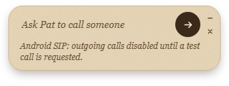

# Pat for Codex

[](https://ko-fi.com/hoppestudios)

[Project / source](https://github.com/HoppeStudios/pat-phone-agent-tool) | [Download review source](https://github.com/HoppeStudios/pat-phone-agent-tool/archive/refs/heads/android-sip-tailscale.zip) | [Install](docs/INSTALLATION.md) | [Releases](https://github.com/HoppeStudios/pat-phone-agent-tool/releases) | [Android over Tailscale](docs/ANDROID_SIP.md)

**Review branch; no packaged fork release yet.** Windows 11 x64, Codex CLI, Czech / English / Russian. Pat: Apache 2.0. Separate Android and telephony components keep their original licenses. Donations are optional; downloading and using the fork does not require a donation.

An MCP server that lets Codex speak on calls through your own phone and SIM. This HoppeStudios fork replaces Claude Code with Codex and adds Czech speech recognition and synthesis.

This is an independent fork of [Pat by azizdaurov](https://github.com/azizdaurov/pat-phone-agent-tool). It is not an official Oasis Team or OpenAI product. Original attribution and the Apache 2.0 license are retained.



Actual application window rendered offscreen for documentation, with a sample setup notice. No call or private contact data is shown.

## Requirements

Choose a transport: the requirements below are for the Windows Bluetooth helper. The experimental [Android SIP guide](docs/ANDROID_SIP.md) instead uses Shizuku, Tailscale and an isolated Asterisk backend, without virtual Windows audio devices.

### Bluetooth

* Windows 11 on an Intel or AMD x64 PC.
* An Android phone or iPhone with a working SIM, outgoing calls and Bluetooth hands free support.
* Codex CLI signed in through ChatGPT and Python 3.12.
* **Windows Developer Mode**, enabled with explicit approval for its machine-wide scope. It is required to register the helper as a development package.
* **Allow this PC to access your mobile devices**, enabled for the Windows user who runs the helper.
* VB CABLE plus a suitable silent virtual speaker, such as an existing Steam Streaming Speakers endpoint or Voicemeeter's virtual speaker. The required endpoints must be enabled and visible.
* Several GB of disk space for local dependencies and speech models.

The helper's build uses pinned Microsoft SDK 10.0.404 and includes .NET runtime 10.0.15. A separate system runtime installation is not needed. Windows administrator approval may be required for Developer Mode or audio drivers. Setup never confirms that prompt or forces a reboot.

**Android can use the new experimental SIP transport over Tailscale.** USB debugging is used for initial helper setup; ongoing calls use the network. Shizuku permission, SIP registration and local synthetic echo have been verified on Android 13. Actual cellular audio and caller ID still need a consenting test call. See [the exact requirements and limits](docs/ANDROID_SIP.md).

## Install

The Codex/Czech foundation is merged in `main`. To include the experimental Android SIP adapter, use its review branch:

```powershell
git clone --branch android-sip-tailscale --single-branch https://github.com/HoppeStudios/pat-phone-agent-tool.git
cd pat-phone-agent-tool
powershell -File .\setup-codex.ps1
```

The software step installs locked Python wheels, verifies Czech speech assets and registers the local `pat-phone` MCP server. It does not pair a phone or place a call.

After approving the two Windows settings listed above:

```powershell
powershell -File .\scripts\Install-PhoneHelper.ps1 -EnableDeveloperMode -EnableMobileAccess
```

Finish audio setup, open `.venv\Scripts\pythonw.exe .\note.py`, complete the name and terms screen, then pair your phone. On Android, allow Calls for the paired PC. Confirm the pairing code on the phone yourself.

Read the complete [installation and first-call guide](docs/INSTALLATION.md), the [Czech guide](docs/INSTALLATION_CS.md), and [Codex and Czech details](CODEX_CZECH.md). The legacy upstream `setup.ps1` is not the recommended installer for this fork.

## What it does

* `place_call` starts the exact call requested by the user.
* `get_call` reports progress and the outcome.
* `end_call` ends a call.
* `take_over` hands a Bluetooth call to the owner. Android SIP does not support handover or incoming answering.
* `contact_notes` and `list_contacts` read local contact information.

Use `language: "cs"` for Czech. English remains the API default. Russian and the existing English voices remain supported. Codex uses its existing account login, without copying credentials into this project.

Calls disclose that the speaker is an AI. The voice agent checks who answered before receiving private task details. Read back names, addresses, quantities, prices and times. Speech recognition and model responses can be wrong.

## Cost and privacy

The fork is free software and does not require a paid telephone API. Existing ChatGPT access and mobile-plan limits or charges still apply. Standard Voicemeeter functions are donationware and optional paid features are not required. Setup does not buy anything.

Contact files and transcripts stay local. Call text and the task are sent to OpenAI through Codex. Do not publish those files. Read [SECURITY.md](SECURITY.md) and the terms before enabling calls.

## Verification

Run `.venv\Scripts\python.exe -m unittest discover` with `QT_QPA_PLATFORM=offscreen` for GUI tests. The ordinary suite uses fake phones and models. The upstream live rehearsal requires `PAT_RUN_LIVE_TESTS=1`. CI never registers a phone, enables Developer Mode or places a call.

The implementation has been checked with regression tests, a real Codex text conversation, a read only MCP tool invocation and silent Czech synthesis and recognition. Those checks do not establish live telephone compatibility. Confirm two-way audio and caller ID with a consenting test recipient before using real orders.

## Structure and credits

`app/` contains the MCP server, Codex integration, profiles and transport adapters. `voice-loop/` provides local speech processing. `iphone-hfp/` is the separate Windows Bluetooth helper. `scripts/` contains pinned setup, scanning and the optional supervised SIP bridge. Private profiles, contacts, call data and SIP secrets are excluded from Git.

The Android route reuses separate [Voice SIP Agent](https://github.com/sparkcyf/android-voice-sip-agent), [Shizuku](https://github.com/RikkaApps/Shizuku) and [Asterisk](https://www.asterisk.org/) installations, with their original credits and licenses. No third-party binaries are relabeled as HoppeStudios work. See [architecture and checks](docs/ANDROID_SIP.md#architecture-and-troubleshooting).

Contributions use review branches and pull requests. See [CONTRIBUTING.md](CONTRIBUTING.md).
