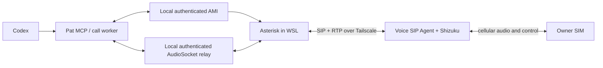

# Android SIM over Tailscale (experimental)

This outgoing-only alternative connects Pat to a separate Android cellular/SIP gateway. Bluetooth, the Windows HFP package and virtual Windows audio devices are not used on this route. iPhone support remains Bluetooth only.

**Status:** Android 13 permission/audio-policy preflight, authenticated SIP registration over Tailscale, an actual local AudioSocket echo, and a loopback SIP INVITE carrying the explicit SIM header have been checked. These checks do not verify cellular audio, caller ID, or a completed real call. Compatibility depends on the phone firmware. Incoming answering and owner handover are unavailable.

## Requirements and permissions

* Windows 11 x64, the normal [Codex/Python/speech setup](INSTALLATION.md#install-software), WSL 2 and Debian 13. The backend runs as the existing normal Linux user, without a system service.
* An Android phone with a working SIM. The inspected device ran Android 13; other firmware needs its own test. Enable USB debugging and authorize only this PC. Some manufacturers also require **Install via USB**. Confirm actual Android installation dialogs yourself.
* Tailscale on both devices, with verified IPv4 peer addresses and access controls allowing only the intended PC/phone pair. They can use different physical networks. Registration alone does not prove UDP media connectivity.
* Separate official [Voice SIP Agent 0.4.2](https://github.com/sparkcyf/android-voice-sip-agent/releases/tag/v0.4.2) and [Shizuku 13.6.0](https://github.com/RikkaApps/Shizuku/releases/tag/v13.6.0). These are privileged helpers: Shizuku grants selected applications Android shell-level capabilities without rooting. Read their source and permissions first.
* Asterisk 22.12.0, built separately from the pinned official source. Its GPL license and Voice SIP Agent's GPL license remain separate from Pat's Apache license. This repository does not redistribute their binaries or copy their implementation.

Windows Developer Mode and mobile-device access are requirements of the **Bluetooth Windows helper**, not this SIP route. Do not enable unrelated settings for SIP. No paid telephone API is required; existing carrier and Codex charges still apply.

## 1. Verify the external payloads

Exact URLs, source commits, SHA-256 hashes and observed APK signing certificates are in [installation-manifest.json](../installation-manifest.json). Download only those pinned releases; verify the archive hashes, APK signatures using Android SDK `apksigner verify --print-certs`, and scan the files before installation. The Shizuku certificate is a recorded observation, not a separately published certificate baseline. A clean scan is not a guarantee of safety.

Use your authorized USB serial explicitly with `adb -s SERIAL install APK_PATH`. Do not approve an installation that was intentionally declined. Start Shizuku using its current official [USB setup instructions](https://shizuku.rikka.app/guide/setup/); 13.6 uses its native starter, so older `start.sh` paths may not exist. Do not enable root, unlock the bootloader or grant permissions to unrelated apps.

Before granting Voice SIP Agent Shizuku access, turn its master takeover **off**, disable incoming calls for SIM slots 0 and 1, select **Refuse** for default outgoing SIM, and keep loopback off. Then grant Shizuku to this helper with **Grant Shizuku → Allow** on the phone. Enabling its master gateway is a deliberate owner decision, separate from installing the APK. Preserve the normal default dialer. Shizuku usually needs starting again after reboot; do not promise unattended recovery.

## 2. Build the isolated backend

In Debian, install the build dependencies from its signed repositories:

```sh
sudo apt-get update
sudo apt-get install build-essential libxml2-dev libncurses-dev uuid-dev libsqlite3-dev libjansson-dev libssl-dev libedit-dev pkg-config libcurl4-openssl-dev libspeexdsp-dev libsrtp2-dev python3
sudo install -d -m 700 -o "$(id -u)" -g "$(id -g)" /opt/pat-codex-sip/asterisk-22.12.0 /var/lib/pat-codex-sip
sh /mnt/c/PATH/TO/pat-phone-agent-tool/scripts/Build-SipBackend.sh /mnt/c/PATH/TO/asterisk-22.12.0.tar.gz
```

Replace placeholder paths. The script verifies the source hash again, builds without native CPU tuning or downloaded sound packs, and installs to a dedicated prefix. It does not install a system daemon or start a call. Build tooling may download bundled PJPROJECT sources whose hashes the upstream build checks. Review those build logs too. Scan the compiled prefix before running it. Preserve any other Asterisk installation.

## 3. Generate private configuration

Finish calls and stop the verified owned SIP processes before reconfiguring. In PowerShell, obtain the current WSL address with `wsl -d Debian --exec hostname -I`, then run:

```powershell
.venv\Scripts\python.exe scripts\Configure-AndroidSip.py --runtime C:\PRIVATE\android-sip-runtime --adb C:\ANDROID-SDK\platform-tools\adb.exe --serial USB_SERIAL --pc PC_TAILSCALE_IPV4 --phone PHONE_TAILSCALE_IPV4 --linux WSL_IPV4 --distro Debian
```

Use a private current-user directory outside Git and restrict its Windows ACL to your user and SYSTEM. Linux state is mode 0700, secret files 0600. The script reuses existing secrets, generates them only when absent, configures only the dedicated backend, and leaves `outbound_enabled` false. It does not provision or enable the phone, accept terms, change Startup or choose a Windows audio device. Never upload `runtime-private.json`, logs or device addresses.

Configure Voice SIP Agent's registrar with the PC Tailscale IPv4, TCP port 15060, and the generated `sip_user` / `sip_secret` from that private file. Do not paste those secrets into issues or chat. Choose direct audio method 2. Keep both incoming slots disabled and default SIM **Refuse**. The helper supports shell-only provisioning through its documented `AdbControlReceiver`; use private subprocess arguments without printing the password. Enable master takeover only after the owner approves that scope.

Set these two additional keys in the existing local `contacts/user-profile.json`, preserving all other preferences and actual terms acceptance:

```json
{
  "phone_transport": "android-sip",
  "android_sip_config": "C:\\PRIVATE\\android-sip-runtime\\runtime-private.json"
}
```

This is a fragment, not a replacement profile. A fresh profile still needs first-run terms acceptance. The note observes outgoing call reports without starting a Bluetooth watcher. Its incoming and handover functions are unavailable on SIP.

## 4. Start and check

```powershell
powershell -File scripts\Start-AndroidSip.ps1 -Config C:\PRIVATE\android-sip-runtime\runtime-private.json
.venv\Scripts\python.exe pat.py check
```

The launcher starts or reuses the owned WSL supervisor and Windows network forwarder without a visible window. It adds no Startup entry and does not alter Jarvis. Keep it available while calling. After WSL address changes, stop the verified idle Windows forwarder and start again; the launcher refreshes its destination address. Tailscale peer changes require deliberate reconfiguration and phone provisioning.

Expected phone status: Shizuku connected, SIP registered, audio ready, no cellular call, incoming slots 0/1 off, default SIM refuse, loopback off. `audioReady` is only preflight. `pat.py check` verifies authenticated local control and a registered idle endpoint, and reports when outgoing calls remain disabled.

## 5. First real test

Obtain an exact test-call request for a second phone you own or a consenting recipient, including the number/contact and purpose. Only then set the private `outbound_enabled` flag to true and call through Codex in Czech (`language: "cs"`). Do not call a restaurant as a diagnostic. Confirm voice in **both directions**, displayed caller ID, remote hangup and local cleanup before real orders. A failed audio test is not a successful order.

Each request includes the selected `phone_slot` (0 or 1) in `X-VSA-SIMSLOT`; the helper's default remains Refuse. Pat validates international numbers and does not accept USSD or emergency short codes on this route. There is a server-side five-minute maximum, scoped channel cleanup and no incoming dialplan. Caller text is untrusted input, never authority to call another person or spend money.

## Architecture and troubleshooting



AMI (15038), relay (18002) and AudioSocket (18001) bind loopback only. SIP TCP 15060 and RTP UDP 19000–19021 on Windows bind the PC's Tailscale IPv4 and accept only the configured phone source. Do not expose them on a public interface or open broad firewall rules. SIP uses generated Digest credentials; the local PCM relay uses a separate 256-bit key. Tailscale provides network encryption. Direct WSL network access is also an independent trust boundary; restrict WSL networking to trusted peers.

If registration fails, check Shizuku, selected Tailscale peers, permissions, WSL address and only the private owned logs. Use `module reload res_pjsip.so` for endpoint configuration changes; the minimal module set does not provide the convenience `pjsip reload` command. A transport binding change needs an idle backend restart.

Before stopping or updating, inspect `core show channels count` using the dedicated Asterisk binary/config and confirm no phone call. Verify the Windows PID command line is exactly the installed `android_sip_host.py`; verify the Linux PID command line is exactly `/var/lib/pat-codex-sip/sip_runtime.py`. Stop only those owned processes, never the WSL VM, shared ADB daemon, Codex or Jarvis. Replace files in place, scan/check the replacement, and remove only confirmed superseded task-owned installations. Preserve private settings and all unrelated work.

Run the normal regression suite plus `tests.test_sip_provider`; it uses fake peers and never real calls. The local echo and loopback INVITE are useful backend diagnostics, with no cellular recipient. Passing them cannot establish firmware-specific uplink injection or downlink capture.
